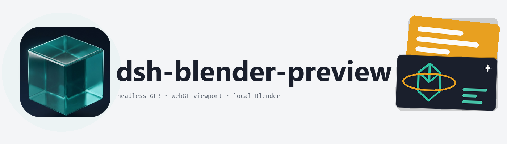

<picture>
  <source media="(prefers-color-scheme: dark)" srcset="assets/banner-dark.png">
  
</picture>

<br>

# dsh-blender-preview

English | [中文](README.zh-CN.md)

     

A [DeepSeek Harness](https://github.com/deepseek-ai/deepseek-harness) plugin that previews Blender `.blend` files (and more) in the right sidebar's Files tab: the host half exports a cached GLB headlessly through your local Blender install, and the browser half renders it in an interactive WebGL viewport with scene statistics.

> **Status: v0.3.0 — the preview works.** `.blend` / `.glb` / `.gltf` / `.obj` open in a 3D viewport, `.svg` in a pixel-true vector viewer, and video/audio stream with seek. The package ships `dsh-blender@^0.2.4` as a dependency with a non-mutating boot self-check, makes no network calls and collects no telemetry. `.blend` conversion needs a local Blender installation; the other formats work without one.

## Install

From npm:

```sh
npx @deepseek-ai/dsh plugin --profile web add dsh-blender-preview
```

Or straight from GitHub:

```sh
npx @deepseek-ai/dsh plugin --profile web add github:adithyanraj03/dsh-blender-preview
```

The package runs no install scripts (no `postinstall`), so pnpm's ignored-builds prompt does not apply. Installing it also pulls one dependency, `dsh-blender@^0.2.4`, into the profile alongside — see [Works with dsh-blender](#works-with-dsh-blender). Confirm it mounted — the plugin must appear in **both** `dependencies` and `dsh.profile.bundles`:

```sh
cd ~/.dsh/profiles/web && node -e "const p=require('./package.json');
  console.log(p.dependencies['dsh-blender-preview'],
              p.dsh.profile.bundles.includes('dsh-blender-preview'))"
```

### In the desktop app

Open **Plugins** (settings, left sidebar) → **Add plugin**, paste the repository address, click **Install**:

```
https://github.com/adithyanraj03/dsh-blender-preview
```

Installed plugins do not update automatically yet — to upgrade, uninstall and install again. The host half loads at startup, so restart the app after installing or upgrading.

## What it does

- **3D viewport** for `.blend`, `.glb`, `.gltf`, `.obj`: drag to orbit, right-drag to pan, scroll to zoom, plus reset-view, spin, wireframe, grid and light-background toggles. Scene chips show triangle / mesh / material counts, animation count and whether the model is rigged.
- **`.blend` conversion** runs your local Blender in the background (`blender -b --factory-startup … --python export_glb.py`) and caches the GLB under `<DSH_HOME>/storages/blender-preview`, keyed by path + size + mtime (or by content for uploaded bytes). Reopening the same file is instant; an edited file converts again.
- **Animation playback**: clip picker, play/pause, a scrub bar and speed control when the model carries clips.
- **`.svg`** renders as a vector drawing with pixel-true zoom and pan.
- **Video / audio** stream over HTTP ranges, so a multi-gigabyte file seeks without being read into memory.

Row config (all optional, on the `blender-preview` row):

| Key | Default | Meaning |
| --- | --- | --- |
| `blenderPath` | auto-detected (`BLENDER_PATH`, common install dirs, PATH) | the Blender executable |
| `timeoutMs` | `180000` | longest one export may take |
| `cacheDir` | `<DSH_HOME>/storages/blender-preview` | where converted GLBs are kept |

## Works with dsh-blender

This package declares [`dsh-blender`](https://github.com/cheshirejcat/blender) (npm `dsh-blender`) by [CheshireJCat](https://github.com/cheshirejcat) as a dependency, so a registry or GitHub install puts `dsh-blender@^0.2.4` into the profile next to this plugin. At boot, the host half runs a **non-mutating self-check**: for every profile that depends on this package it verifies that `dsh-blender` is installed in that profile and mounted in its `dsh.profile.bundles`, and when either is missing it logs the exact one-liner that repairs it:

```sh
npx @deepseek-ai/dsh plugin --profile web add dsh-blender
```

The self-check reads; it never installs or edits anything itself. This matters for `link:` dev profiles, where pnpm does not install the linked package's own dependencies — the check reports the gap instead of assuming it away.

**Credit:** `dsh-blender` is a community plugin by [CheshireJCat](https://github.com/cheshirejcat) — Blender modelling tools and skills for dsh.

## Prior art

`dsh-blend-preview` on npm is taken and deprecated; its author renamed it to `dsh-preview-blender`, which already implements headless-GLB + WebGL sidebar preview. This is an independent implementation under the `dsh-blender-preview` name, verified available on npm when this plugin was created.

## Development

```sh
npm install                     # dev deps: three + esbuild-wasm (no native esbuild, no postinstall)
npm run build                   # bundle src/client -> lib/client.js (esbuild-wasm)
npm test                        # wiring harness + unit tests + e2e export
BLEND_SAMPLE=/path/to/file.blend npm test   # include the real Blender .blend->GLB e2e test
python scripts/make-banner.py   # regenerate the README banners (Pillow)
```

| Path | Role |
| --- | --- |
| `src/index.js` | host half — dsh-blender boot self-check, convert/media/status routes |
| `src/convert.js` | Blender resolution, headless export, on-disk GLB cache |
| `src/export_glb.py` | the Blender-side export script |
| `src/client/` | browser half sources — viewport, SVG, media, registration |
| `lib/client.js` | built browser bundle (generated by `build.mjs`) |
| `build.mjs` | esbuild-wasm bundler wrapped in dsh's module loader |
| `cordis.patch.yml` | mounts the host row; `name` must equal the package name |
| `scripts/test-harness.mjs` | dependency-free wiring test |
| `test/preview.test.mjs` | unit + cache + Blender e2e tests |
| `docs/` | GitHub Pages site |
| `assets/` | icon and banners |

## Compatibility

| Host | Status |
| --- | --- |
| dsh 0.2.x (web + desktop) | working; restart after install/upgrade so the host half loads |

`.blend` conversion requires a local Blender installation (tested against Blender 5.2 LTS). `.glb` / `.gltf` / `.obj` / `.svg` / video / audio previews work without Blender.

## License

MIT © Adithya N Raj
