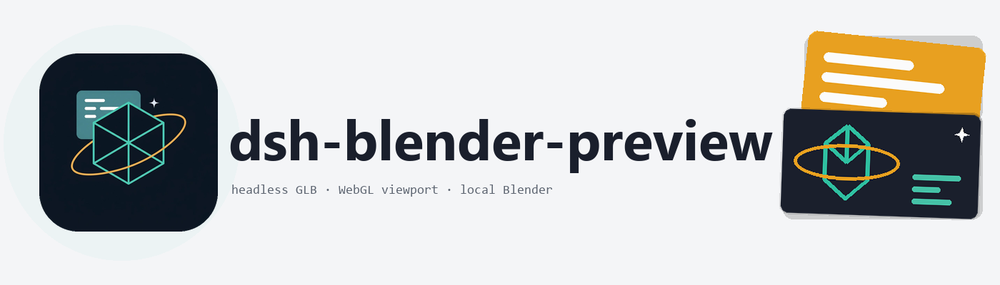

<picture>
  <source media="(prefers-color-scheme: dark)" srcset="assets/banner-dark.png">
  
</picture>

<br>

# dsh-blender-preview

[English](README.md) | 中文

     

一个 [DeepSeek Harness](https://github.com/deepseek-ai/deepseek-harness) 插件，将用于在右侧边栏预览 Blender `.blend` 文件：宿主半区通过本机 Blender 以无头模式导出带缓存的 GLB，浏览器半区在可交互的 WebGL 视口中渲染，并显示场景统计信息。

> **状态：脚手架（v0.1.0）。** 本版本发布的是项目接线，而非功能本身：bundle 行可以挂载，包不发起任何网络请求、不收集任何遥测，也尚未预览任何场景。无头 GLB 导出与 WebGL 视口将在后续版本落地。

## 安装

从 npm 安装：

```sh
npx @deepseek-ai/dsh plugin --profile web add dsh-blender-preview
```

或直接从 GitHub 安装：

```sh
npx @deepseek-ai/dsh plugin --profile web add github:adithyanraj03/dsh-blender-preview
```

本包不运行任何安装脚本（无 `postinstall`），因此不会触发 pnpm 的 ignored-builds 提示。确认挂载成功——插件必须**同时**出现在 `dependencies` 和 `dsh.profile.bundles` 中：

```sh
cd ~/.dsh/profiles/web && node -e "const p=require('./package.json');
  console.log(p.dependencies['dsh-blender-preview'],
              p.dsh.profile.bundles.includes('dsh-blender-preview'))"
```

### 在桌面应用中

打开 **Plugins**（设置，左侧边栏）→ **Add plugin**，粘贴仓库地址，点击 **Install**：

```
https://github.com/adithyanraj03/dsh-blender-preview
```

已安装的插件尚不支持自动更新——升级时需先卸载再重新安装。宿主半区在启动时加载，因此安装或升级后需重启应用。

## 本脚手架版本包含的内容

- 宿主行（`id: blender-preview`）可在 dsh web 与桌面版上挂载。行 id 自本版本起永久固定——后续版本只替换行的 config，不改变 id。
- `npm test`——无依赖的接线测试：检查包名在三个位置（package.json、cordis.patch.yml、src/client.js）一致，且所有随包文件均存在。
- 双语 README、文档站点（GitHub Pages），以及发布流程：每个 release 均附带 `plugin.tgz` 资源与详细说明。

计划中的功能，一句话概括：本地 `blender --background` 进程将当前 `.blend` 导出为带缓存的 GLB（仅在文件变化时重新导出），右侧边栏在可交互的 WebGL 视口中渲染该 GLB 并显示场景统计信息。一切均基于本机 Blender 安装——无云服务、无 API 密钥。

## 已有同类插件

npm 上的 `dsh-blend-preview` 已被占用且已弃用；其作者将其更名为 `dsh-preview-blender`，后者已实现无头 GLB + WebGL 侧边栏预览。本插件是以 `dsh-blender-preview` 名称（创建脚手架时已验证该名称在 npm 可用）进行的独立实现。

## 开发

```sh
npm test                        # 接线测试
python scripts/make-banner.py   # 重新生成 README 横幅（Pillow）
```

目录结构沿用 [dsh-graft](https://github.com/adithyanraj03/dsh-graft-plugin)：

| 路径 | 职责 |
| --- | --- |
| `src/index.js` | 宿主半区——Blender 解析 + 带缓存的 GLB 导出（占位） |
| `src/client.js` | 浏览器半区——侧边栏标签 + WebGL 视口（占位） |
| `cordis.patch.yml` | 挂载宿主行；`name` 必须与包名一致 |
| `scripts/test-harness.mjs` | 无依赖接线测试 |
| `scripts/make-banner.py` | 重新生成 `assets/banner-*.png` |
| `docs/` | GitHub Pages 站点 |
| `assets/` | 图标与横幅 |

## 兼容性

| 宿主 | 状态 |
| --- | --- |
| dsh 0.2.x（web + 桌面版） | 行可挂载；功能未实现 |

功能实现后，运行时需要本机安装 Blender（路径解析逻辑随功能实现一起提供）。

## 许可证

MIT © Adithya N Raj
